# Matheus Ricoy · Portfólio F1 🏎️

<p align="center">
  
</p>

Portfólio pessoal com tema de **Fórmula 1**, feito em **React + Vite**. Cada parte da minha trajetória virou um elemento de corrida: os projetos são carros na **Garagem**, as tecnologias são **Troféus**, as experiências são **Equipes**, o curso é a **Temporada** e o contato é o **Rádio da Equipe**.

---

## 🚧 Status do Projeto


---

## 📚 Índice

- [Links Úteis](#-links-úteis)
- [Sobre o Projeto](#-sobre-o-projeto)
- [Funcionalidades](#-funcionalidades)
- [Tecnologias](#️-tecnologias)
- [Arquitetura](#️-arquitetura)
- [Instalação e Execução](#-instalação-e-execução)
- [Deploy](#-deploy)
- [Estrutura de Pastas](#-estrutura-de-pastas)
- [Demonstração](#-demonstração)
- [Testes](#-testes)
- [Documentações utilizadas](#-documentações-utilizadas)
- [Autores](#-autores)
- [Contribuição](#-contribuição)
- [Agradecimentos](#-agradecimentos)
- [Licença](#-licença)

---

## 🔗 Links Úteis

- 💻 **Repositório:** [github.com/Cirker1226/RicoyPortfolio](https://github.com/Cirker1226/RicoyPortfolio)
- 👤 **GitHub:** [github.com/Cirker1226](https://github.com/Cirker1226)
- 💼 **LinkedIn:** [linkedin.com/in/matheushenrique1226](https://www.linkedin.com/in/matheushenrique1226/)
- 🌐 **Site publicado:** [ricoy-portfolio.vercel](https://ricoy-portfolio.vercel.app)

---

## 📝 Sobre o Projeto

Sou estudante de **Engenharia de Software na PUC Minas** e criei este portfólio para reunir meus projetos, as tecnologias que já usei e minhas experiências em um só lugar, de um jeito que tivesse a minha cara: apaixonado por F1, transformei o site inteiro em um fim de semana de corrida.

O objetivo é ter uma vitrine simples de manter: **todo o conteúdo fica em arquivos de dados** (`src/data`), então adicionar um projeto, um troféu ou uma experiência é só editar um objeto JavaScript, sem mexer nos componentes.

---

## ✨ Funcionalidades

| Nº | Seção | O que mostra |
|----|-------|--------------|
| — | **Grid** | Tela inicial com apresentação, botões de ação e um "editor" com o `piloto.js` |
| 01 | **Ficha do Piloto** | Foto, dados pessoais e resumo de quem eu sou |
| 02 | **Fora das Pistas** | Hobbies (jogos, corridas e carros) com galeria de imagens |
| 03 | **Sala de Troféus** | Tecnologias como troféus de ouro, prata e bronze; as apagadas são as próximas metas |
| 04 | **Garagem** | Projetos como carros, com filtro por composto do pneu (Macio = front-end, Médio = back-end, Duro = full-stack) e links para código e demo |
| 05 | **Equipes** | Experiências profissionais e de ensino |
| 06 | **Temporada** | As 8 rodadas (semestres) do curso, com as disciplinas da grade |
| 07 | **Rádio da Equipe** | Canais de contato: Gmail e Discord copiam o texto, LinkedIn e GitHub abrem o perfil |

Outros detalhes:

- 📱 **Layout responsivo**, com regras próprias em cada módulo de CSS.
- 🧭 **Menu fixo** no topo com navegação por âncoras entre as seções.
- 🗂️ **Conteúdo separado do código**: cada seção lê seu próprio arquivo em `src/data`.

---

## 🛠️ Tecnologias

### 💻 Front-end

- **[React 19](https://react.dev/)** — componentes da interface
- **[Vite 8](https://vite.dev/)** — servidor de desenvolvimento e build
- **[React Compiler](https://react.dev/learn/react-compiler)** — otimização automática dos componentes (via `babel-plugin-react-compiler`)
- **CSS Modules** — um arquivo `.module.css` por componente, sem conflito de nomes de classe
- **[Bootstrap Icons](https://icons.getbootstrap.com/)** — ícones do menu e do Rádio
- **[Devicon](https://devicon.dev/)** — ícones das tecnologias na Sala de Troféus
- **[Titillium Web](https://fontsource.org/fonts/titillium-web)** — fonte com cara de F1

### 🧰 Ferramentas

- **[ESLint 10](https://eslint.org/)** com `eslint-plugin-react-hooks` e `eslint-plugin-react-refresh`
- **Git & GitHub** — versionamento
- **VS Code** — editor

---

## 🏗️ Arquitetura

O site é uma página única (SPA). O `main.jsx` monta todas as seções em ordem, e cada componente busca seu conteúdo no arquivo de dados correspondente.

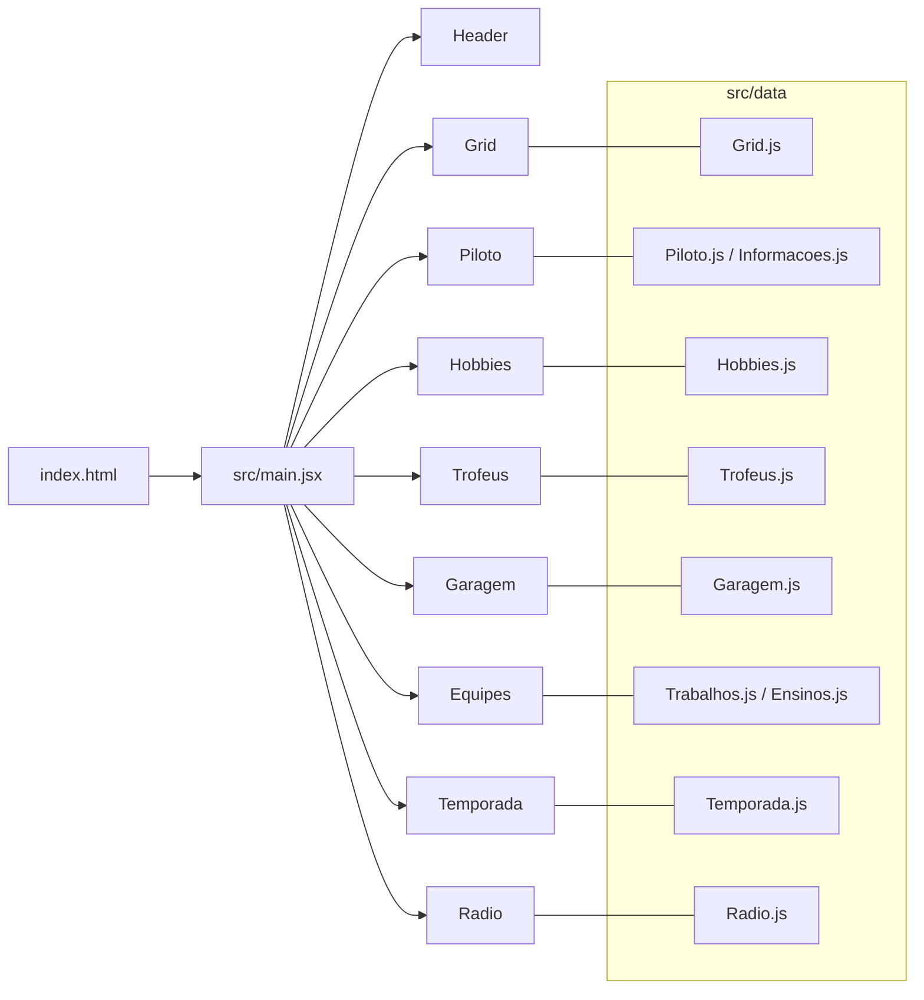

Cada componente segue o mesmo padrão de três arquivos:

```
src/components/Garagem.jsx      → estrutura (JSX)
src/css/Garagem.module.css      → estilo e responsividade
src/data/Garagem.js             → conteúdo (textos, links, imagens)
```

---

## 🔧 Instalação e Execução

### ✅ Pré-requisitos

- **[Node.js](https://nodejs.org/)** `20.19+` ou `22.12+` (exigência do Vite 8)
- **npm** (já vem com o Node)
- **Git**

### 📥 Clonando o repositório

```bash
git clone https://github.com/Cirker1226/RicoyPortfolio.git
cd RicoyPortfolio
```

### 📦 Instalando as dependências

```bash
npm install
```

### ▶️ Executando em modo de desenvolvimento

```bash
npm run dev
```

O site abre em **http://localhost:5173**.

### 📜 Outros comandos

| Comando | O que faz |
|---------|-----------|
| `npm run dev` | Sobe o servidor de desenvolvimento com recarregamento automático |
| `npm run build` | Gera a versão final otimizada na pasta `dist/` |
| `npm run preview` | Abre localmente a versão gerada pelo `build` |
| `npm run lint` | Verifica o código com o ESLint |

---

## 🚀 Deploy

O site ainda não foi publicado. Como é um projeto estático, basta gerar o build:

```bash
npm run build
```

e publicar a pasta `dist/` em qualquer hospedagem de sites estáticos, como **[Vercel](https://vercel.com/)**, **[Netlify](https://www.netlify.com/)** ou **[GitHub Pages](https://pages.github.com/)**. Na Vercel e na Netlify, o projeto Vite é detectado sozinho (comando `npm run build`, pasta `dist`).

---

## 📂 Estrutura de Pastas

```
RicoyPortfolio/
├── docs/
│   └── prints/              # capturas de tela usadas neste README
├── public/                  # arquivos servidos direto pelo site
│   ├── garagem/             # imagens dos projetos
│   ├── hobbies/             # imagens dos hobbies
│   ├── icon.png             # logo e favicon
│   └── image.png            # foto da Ficha do Piloto
├── src/
│   ├── components/          # um componente React por seção
│   │   ├── Header.jsx
│   │   ├── Grid.jsx
│   │   ├── Piloto.jsx
│   │   ├── Hobbies.jsx
│   │   ├── Trofeus.jsx
│   │   ├── Garagem.jsx
│   │   ├── Equipes.jsx
│   │   ├── Temporada.jsx
│   │   └── Radio.jsx
│   ├── css/                 # um CSS Module por componente + global.css
│   ├── data/                # conteúdo de cada seção
│   └── main.jsx             # ponto de entrada: monta todas as seções
├── eslint.config.js
├── index.html
├── package.json
├── vite.config.js
├── LICENSE
└── README.md
```

---

## 🎥 Demonstração

### 🏁 Grid (tela inicial)

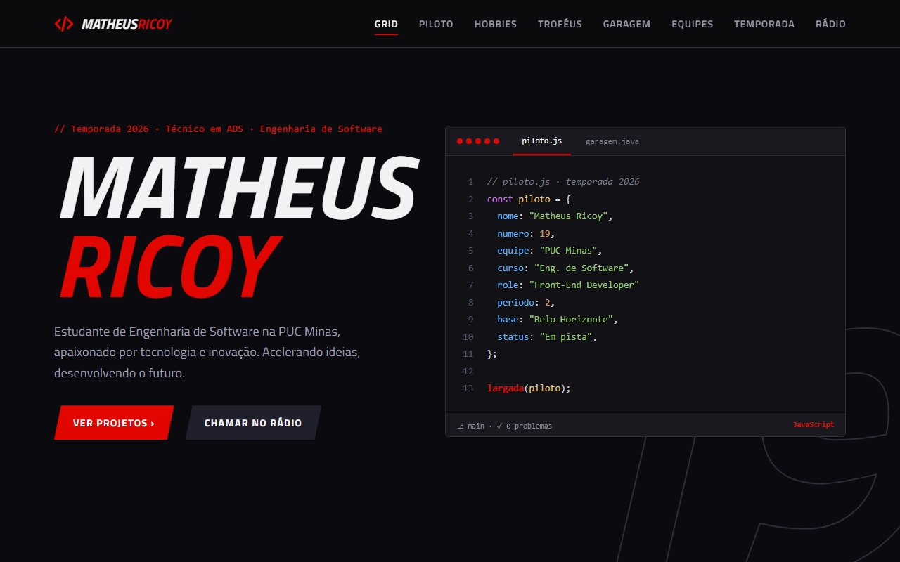

### 01 · Ficha do Piloto

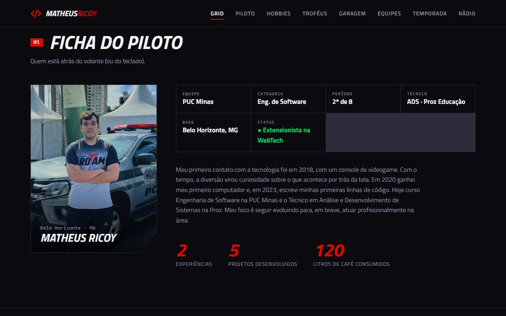

### 02 · Fora das Pistas

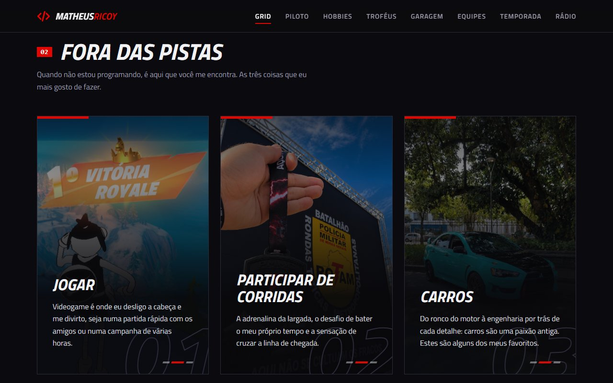

### 03 · Sala de Troféus

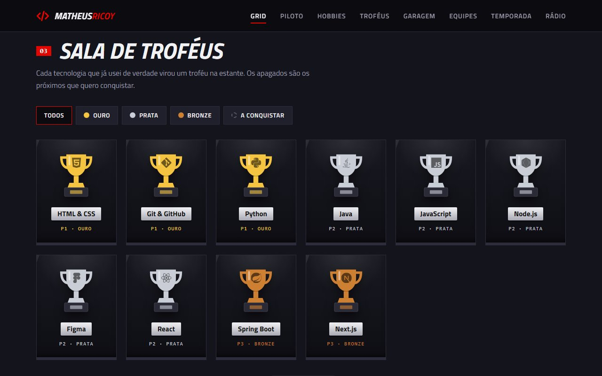

### 04 · Garagem

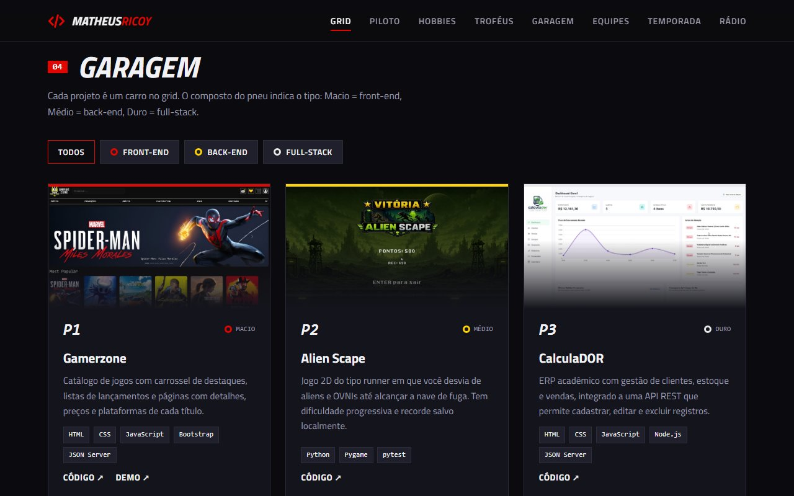

### 05 · Equipes

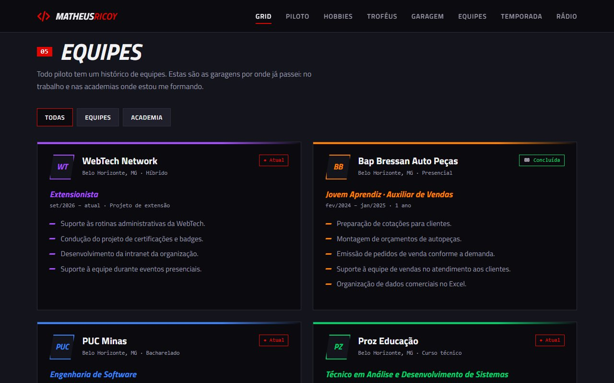

### 06 · Temporada

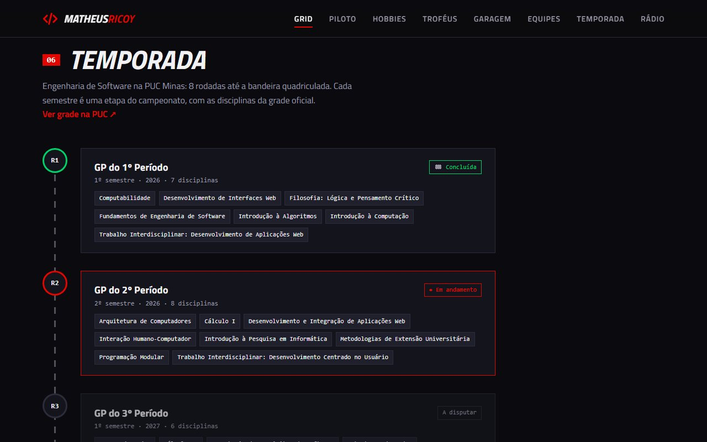

### 07 · Rádio da Equipe

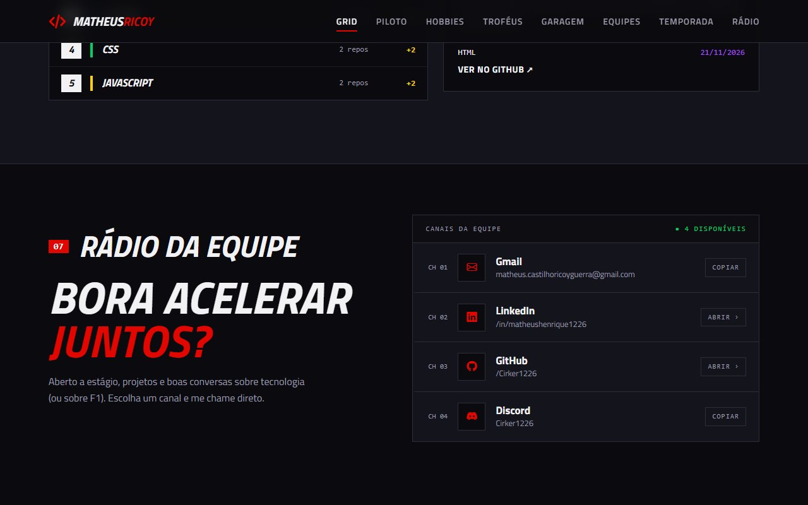

### 📱 No celular

<p align="center">
  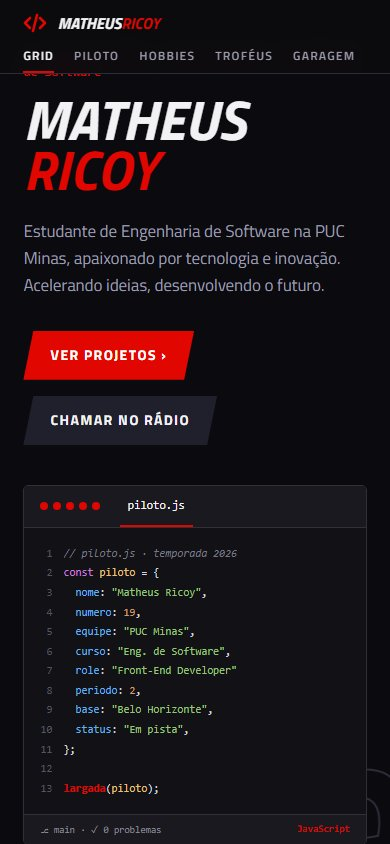
  &nbsp;&nbsp;
  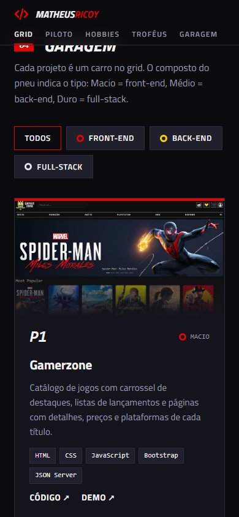
</p>

---

## 🧪 Testes

O projeto ainda não tem testes automatizados. Por enquanto, a qualidade do código é verificada com o **ESLint**:

```bash
npm run lint
```

e a interface é conferida manualmente no navegador, em tamanhos de tela de computador, tablet e celular.

---

## 📖 Documentações utilizadas

- [Documentação do React](https://react.dev/learn)
- [Documentação do Vite](https://vite.dev/guide/)
- [CSS Modules no Vite](https://vite.dev/guide/features.html#css-modules)
- [MDN Web Docs — HTML, CSS e JavaScript](https://developer.mozilla.org/pt-BR/)
- [Bootstrap Icons](https://icons.getbootstrap.com/)
- [Devicon](https://devicon.dev/)

---

## 👥 Autores

| 👤 Nome | 🖼️ Foto | :octocat: GitHub | 💼 LinkedIn | 📤 Gmail |
|---------|---------|-----------------|-------------|----------|
| Matheus Henrique (Ricoy) | <div align="center"></div> | <div align="center"><a href="https://github.com/Cirker1226"></a></div> | <div align="center"><a href="https://www.linkedin.com/in/matheushenrique1226/"></a></div> | <div align="center"><a href="mailto:matheus.castilhoricoyguerra@gmail.com"></a></div> |


## 🙏 Agradecimentos

- À **PUC Minas** e aos professores do curso de Engenharia de Software.
- Ao **Prof. Rommel Vieira Carneiro**, pelo modelo de README usado como base.

---

## 📄 Licença

Este projeto está sob a licença **MIT**. Consulte o arquivo [LICENSE](LICENSE) para mais detalhes.
